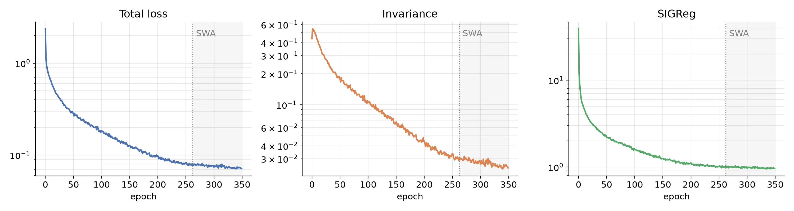
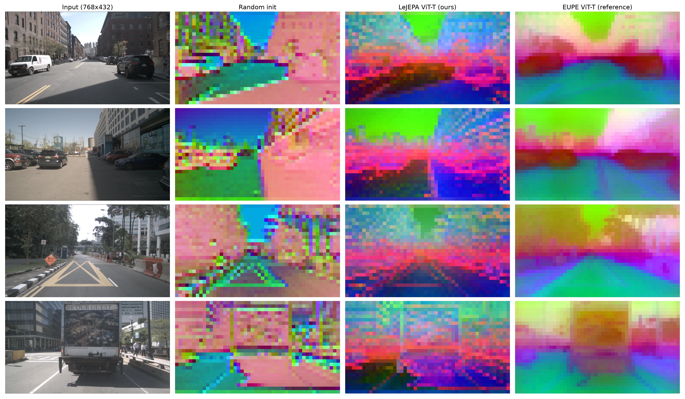

# LeJEPA from scratch

Minimal LeJEPA [[1]](#references) implementation in PyTorch, with code to pretrain a
ViT-Tiny from scratch on the front-camera images of nuImages [[2]](#references).
Everything runs on Kaggle's free 2×T4 GPUs within a single 12-hour session.

## Method

LeJEPA learns by making the embeddings of different views of the same image agree,
while the SIGReg regularization keeps the embeddings close to an isotropic Gaussian so
they can't collapse. You can read more about the method in
[this post](https://mlhonk.substack.com/p/69-lejepa-ssl-without-the-heuristics?r=50rx1o&utm_campaign=post-expanded-share&utm_medium=web).
This codebase uses the following defaults:

- **Views:** 4 random 256×256 crops per frame (20–100% of the frame), all with the same
  augmentation: color jitter, grayscale, Gaussian blur, solarize, horizontal flip.
- **Encoder:** ViT-Tiny/16 (5.5M parameters, 192 dims, 12 blocks, 3 heads) with 2D RoPE
  only. During training, 30% of the patch tokens of each view are dropped at random.
- **Projector:** an MLP, 192 → 384 → 384 → 64, with BatchNorm and ReLU.
- **Loss:** `(1 - λ) · invariance + λ · SIGReg` with `λ = 0.05`.
  - Invariance is the mean squared distance between each view's embedding and the mean
    over the 4 views.
  - SIGReg applies the Epps–Pulley test to 1024 random 1-D projections of the
    embeddings.
- **Optimization:**
  - AdamW, learning rate 3e-3, weight decay 0.05, global batch 384 for 350 epochs.
  - 1 epoch of warmup, then cosine annealing to a tenth of the peak learning rate.
  - Weight averaging (SWA) over the last 25% of epochs.
  - fp16 mixed precision.

## Usage

Set up the environment with [uv](https://docs.astral.sh/uv/), then train:

```bash
uv sync
uv run torchrun --nproc_per_node=2 train.py  # single GPU: uv run python train.py
```

The dataset ([`mviola/nuImages-cam-front`][dataset], 13.187 train / 3.249 validation
frames) downloads on the first run. Each run writes logs, checkpoints and PCA images to
`run/<timestamp>/`.

[dataset]: https://huggingface.co/datasets/mviola/nuImages-cam-front

To change the hyperparameters, edit the defaults of `Config` in [`train.py`](train.py):

```python
@dataclass
class Config:
    # Loss
    lambd: float = 0.05  # SIGReg weight

    # DataLoader
    n_global: int = 4  # 256×256 views per image
    n_local: int = 0  # optional 112×112 local views
    batch_size: int = 384  # global, split across GPUs
    num_workers: int = 4

    # Optimizer
    learning_rate: float = 3e-3
    weight_decay: float = 5e-2
    epochs: int = 350

    # SIGReg
    num_slices: int = 1024
    knots: int = 17
    t_max: float = 5.0

    # Checkpoints
    run_name: str = "auto"  # "auto" uses the current date and time
    save_every: int = 10  # epochs
```

## Results

Training takes about 11 hours and runs smoothly: the losses decrease steadily with no
collapse.



PCA of the patch features on validation frames. Random init is basically a brightness
and edge encoder, so it splits the road along shadows and road lines. The trained
encoder captures semantics a bit better, but not individual objects. As an upper bound
on quality at this size, we report EUPE ViT-T/16 [[3]](#references), distilled from
large teachers on 1.7B images.



## References

[1] R. Balestriero and Y. LeCun, "LeJEPA: Provable and Scalable Self-Supervised Learning
Without the Heuristics"

[2] H. Caesar et al., "nuScenes: A Multimodal Dataset for Autonomous Driving"

[3] C. Zhu et al., "Efficient Universal Perception Encoder"
